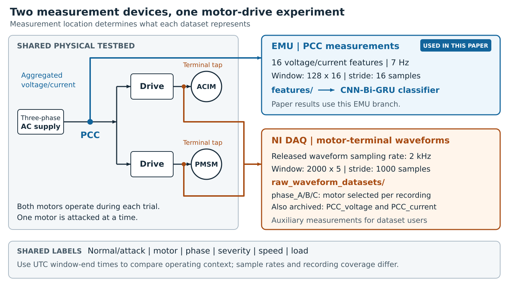

# EMU and NI DAQ Dataset Measurement Guide

The APEC2027 manuscript, **Real-Time Cyber Attack Detection Using IoT-Based
Electric Measurement Units at the Point of Common Coupling (PCC)**, evaluates
the EMU measurements at the PCC. NI DAQ provides a separate motor-terminal
waveform stream for auxiliary analysis of the same testbed experiments.

The blue branch supplies the paper's classifier. The orange branch identifies
the NI DAQ recording path. Both motors operate during each trial while one is
attacked. The EMU measures their aggregate electrical interaction at the PCC.
The NI DAQ terminal taps observe the motor phase currents. In each released
five-channel recording, phase_A/B/C correspond to the motor selected for that
case (ACIM or PMSM). Its released archive
also contains the channels named `PCC_voltage` and `PCC_current`; the NI archive
therefore contains both motor-terminal and PCC reference channels.

## Choose a measurement stream

| Device | Measurement location | Released data | Window and stride | Dataset folder |
|---|---|---|---|---|
| EMU | Point of common coupling, upstream of both motor drives | 16 current/voltage features, nominal 7 Hz | 128 x 16 inputs; stride 16 time steps | `features/` |
| NI DAQ | Motor terminals, plus archived PCC reference channels | Five waveform channels, released at 2 kHz | 2000 x 5 inputs; stride 1000 samples | `raw_waveform_datasets/` |

EMU features are `IF_Amplitude`, `IF_Amplitude2`, `IF_Frequency`,
`IF_Frequency2`, `IF_Phase`, `IF_RMS`, `IF_ROCOF`, `IF_THD`, and the eight
corresponding voltage fields prefixed `VF_`. The NI DAQ channel order is
`phase_A`, `phase_B`, `phase_C`, `PCC_voltage`, `PCC_current`.

The two branches are separate measurement devices. EMU feature measurements
are generated by the EMU; the diagram does not imply that they are computed
from the archived NI DAQ samples. The NI DAQ rate is the released rate after
downsampling, not a claim about the original acquisition hardware rate.

## Release v1.0.0 coverage

| Device | Files | Windows | Normal | Attack |
|---|---:|---:|---:|---:|
| EMU | 10 | 117,396 | 22,829 | 94,567 |
| NI DAQ | 16 | 498,574 | 165,350 | 333,224 |

These counts describe the curated dataset release prepared separately from
this manuscript repository. They do not identify the exact training artifact
used for the manuscript's reported evaluation. Dataset archives and a Zenodo
DOI are not included in this repository at present.

The EMU release retains the existing trimmed January 24 file and excludes its
overlapping full copy. Three attack IDs (1056, 1057 and 1058) are absent in EMU
features but present in NI DAQ. The January 8 EMU recording has no supplied
NI DAQ counterpart. Attack IDs 321..360 recur across January 8 and January 9;
identify a trial using recording/time together with attack ID.

## Read and align the data

Each NPZ stores `X` (measurements), `y` (13 labels), `t` (UTC window-end times),
`x_columns`, `y_columns`, `dataset_version`, `operating_context_valid`, and
`operating_context_source`. Use the column-name arrays when selecting fields.

The labels are `is_attack`, `is_onset`, `attack_id`, `attack_type`, `Motor`,
`A`, `B`, `C`, `severity_A`, `severity_B`, `severity_C`, `speed`, and `load`.
Motor context is 1=ACIM and 2=PMSM. Speed and load describe experimental
setpoints/load levels, including during normal operation. Load levels are
not calibrated torque units.

Compare operating context by UTC window-end timestamp, not by row number.
The release aligns context using fixed-condition NI DAQ recording intervals.
This does not establish sample-level synchronization or correct sensor clock
offsets. EMU windows span approximately 18 seconds; NI DAQ windows span one
second. Their window-level attack flags and onset indices need not agree at
nearby timestamps because the covered intervals differ.

There are 1,367 normal EMU windows in transition gaps whose exact condition
switch time is unknown. Their original context values are retained with
`operating_context_valid=False`. Filter these when an analysis requires
supported speed/load labels. The flag describes endpoint context, not
stationarity over the whole window. NI DAQ normal context is filled from each
recording's unique motor/speed/load metadata, assuming a constant condition
within that case. The release's validation report records the checks and
limitations. Adjacent windows overlap; split by recording/time to avoid
sharing overlapping windows between training and evaluation.

## Reuse the figure

- [Vector PDF for LaTeX](figures/dataset_measurement_paths.pdf)
- [Editable SVG for documentation](figures/dataset_measurement_paths.svg)
- [Figure generator](tools/draw_dataset_measurement_paths.py)

Run `python tools/draw_dataset_measurement_paths.py` from this repository to
regenerate both figures; the generator requires `reportlab` and `pypdf`.
The manuscript includes the PDF in its dataset-structure section.
